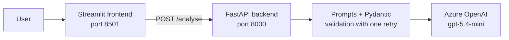

# Job Advert Analyser

Paste a job advert and get back its key details as structured data, three CV bullet suggestions tailored to the role, and an LLM judge's assessment of those bullets.

Built end to end as a learning project: prompt engineering, structured output with Pydantic validation, an accuracy comparison on a hand-labelled dataset, an LLM-as-a-judge calibrated against my own scores, a FastAPI backend, a Streamlit frontend, and Docker.

## Example

**Input**

> Junior Data Analyst, Manchester (hybrid, 3 days in office). £28,000-£32,000. You'll need SQL, Excel and Power BI; Python is a plus. 0-2 years' experience.

**Extracted**

```json
{
  "job_title": "Data Analyst",
  "seniority": "junior",
  "required_skills": ["SQL", "Excel", "Power BI"],
  "nice_to_have_skills": ["Python"],
  "salary_min": 28000,
  "salary_max": 32000,
  "remote": "hybrid"
}
```

The app then writes three CV bullets for the role and scores them 1–5 on relevance, specificity and honesty, with a reason.

## Architecture



The frontend only talks to the backend and never calls the LLM directly, so the Azure key, prompts, validation and error handling all live in one place.

Each request to `/analyse` makes three LLM calls:

1. **Extract** the job fields (few-shot prompt), validated against `JobExtraction`
2. **Write** three CV bullets, validated against `CVBullets`
3. **Judge** the bullets against a rubric, validated against `JudgeScore`

If a reply fails Pydantic validation, the model's answer and the validation error are sent back once for a corrected reply. A second failure returns an error rather than bad data.

## Tech stack

Python 3.12 · Azure OpenAI (`gpt-5.4-mini`, v1 API) · Pydantic · FastAPI · Uvicorn · Streamlit · httpx · pandas · Docker Compose

## Project structure

```
backend/
  main.py           FastAPI app: GET /health, POST /analyse
  llm.py            Azure client, validation with one retry, extract / bullets / judge
  prompts.py        Four extraction techniques, CV bullet prompt, judge rubric
  schemas.py        Pydantic models for LLM output and the API
  validate_data.py  Checks every label in the dataset against the schema
  try_*.py          Small scripts used to test each stage
  Dockerfile
frontend/
  app.py            Streamlit page that calls the backend
  Dockerfile
notebooks/
  01_prompt_comparison.ipynb   Accuracy of four prompting techniques
  02_judge_calibration.ipynb   LLM judge vs my own scores
data/
  examples.json        24 hand-labelled synthetic job adverts
  LABELLING_RULES.md   The rules every label follows
  results_*.json, judge_*.json, calibration_*.json, human_scores.json   Saved evaluation runs
docker-compose.yml
.env.example
requirements-dev.txt
```

## Quick start (Docker)

You need [Docker Desktop](https://www.docker.com/products/docker-desktop/) and an Azure OpenAI deployment.

```bash
git clone https://github.com/<your-username>/job-advert-analyser.git
cd job-advert-analyser
cp .env.example .env        # Windows PowerShell: Copy-Item .env.example .env
```

Fill in `.env`:

```
AZURE_OPENAI_ENDPOINT=https://<your-resource>.openai.azure.com
AZURE_OPENAI_API_KEY=<your-key>
AZURE_OPENAI_DEPLOYMENT=<your-deployment-name>
```

Then start everything:

```bash
docker compose up --build
```

- App: http://localhost:8501
- API docs: http://localhost:8000/docs

`.env` is never copied into either image. Docker Compose passes its values to the backend container as environment variables at runtime.

## Running locally (without Docker)

```bash
python -m venv .venv
.venv\Scripts\activate          # macOS/Linux: source .venv/bin/activate
pip install -r requirements-dev.txt
```

Terminal 1 (backend):

```bash
uvicorn main:app --reload --app-dir backend
```

Terminal 2 (frontend):

```bash
streamlit run frontend/app.py
```

To rerun the evaluation, open the notebooks with the `.venv` kernel. Saved results are loaded from `data/` if present; delete a results file to force a fresh run.

## API

| Method | Path | Purpose |
|---|---|---|
| GET | `/health` | Service status and whether Azure settings are present (does not call Azure) |
| POST | `/analyse` | Body `{"advert": "..."}`; returns the extraction, 3 bullets, the judge's scores, the technique used and the number of retries |

| Status | Meaning |
|---|---|
| 200 | Success |
| 400 | Valid request, but the advert can't be used: under 50 characters after trimming, or rejected by Azure's content filter |
| 422 | Request is the wrong shape: missing `advert`, wrong type or extra fields (FastAPI validation) |
| 502 | The model returned invalid output twice, even after the retry |
| 503 | Azure OpenAI is unreachable, timed out, rate-limited or misconfigured |

## Prompt engineering and accuracy

### Dataset

24 synthetic job adverts, each labelled by hand following [`data/LABELLING_RULES.md`](data/LABELLING_RULES.md). The set deliberately includes hard cases: day, hourly and monthly rates (salary must be null), "up to" and "from" salaries, Lead and Principal titles, remote-first roles with occasional office visits, skills buried in prose, and soft skills that must be excluded. It is balanced across seniority (8 junior, 9 mid, 7 senior) and working pattern (6 remote, 9 hybrid, 9 onsite). `validate_data.py` checks every label against the Pydantic schema.

### Techniques

All four prompts share the same task, labelling rules and field list, so each technique changes one thing only:

| Technique | What it adds |
|---|---|
| Zero-shot | Instructions, rules and the advert |
| Few-shot | Three worked examples (none taken from the test set) |
| Role / system | Instructions moved into a system message with an expert persona |
| Chain of thought | Step-by-step reasoning before the answer, returned in a `reasoning` field |

### Results

Field-level accuracy (%) on 24 adverts. Skills are compared as case-insensitive sets, so order doesn't matter, but every skill must match.

| Technique | job_title | seniority | required_skills | nice_to_have_skills | salary_min | salary_max | remote | overall | all fields correct |
|:--|--:|--:|--:|--:|--:|--:|--:|--:|--:|
| zero_shot | 100 | 100 | 87.5 | 100 | 100 | 100 | 100 | 98.2 | 87.5 |
| few_shot | 100 | 100 | **95.8** | 100 | 100 | 100 | 100 | **99.4** | **95.8** |
| role | 100 | 100 | 87.5 | 100 | 100 | 100 | 100 | 98.2 | 87.5 |
| chain_of_thought | 100 | 100 | 91.7 | 100 | 100 | 100 | 100 | 98.8 | 91.7 |

| Technique | avg seconds | retries | failures |
|:--|--:|--:|--:|
| zero_shot | 0.8 | 0 | 0 |
| few_shot | 0.8 | 0 | 0 |
| role | 1.0 | 0 | 0 |
| chain_of_thought | 1.2 | 0 | 0 |

### Chosen technique: few-shot

All four techniques scored 100% on six of the seven fields, so the comparison came down to `required_skills`. Few-shot made the fewest mistakes (1 of 24 adverts, 95.8% fully correct), compared with 2 for chain of thought and 3 each for zero-shot and role. Its worked examples showed rules being applied, such as dropping soft skills, which zero-shot and role got wrong on ex18. Few-shot sends longer prompts and so uses more input tokens than zero-shot, but it was no slower (0.8s on average). Chain of thought cost more output tokens and time (1.2s) without being more accurate. The role persona made no measurable difference over zero-shot.

**Caveats:** the gaps are small (one advert is about 4 percentage points) and come from a single run on 24 examples. The remaining errors (ex12 "HR reporting", ex23 "backups") are boundary cases of what counts as a skill. Labels were not changed after seeing model output, to avoid tuning the test set to the model.

## LLM as a judge

The judge scores the three CV bullets as a set, from 1 to 5, on:

- **Relevance:** are the bullets built around this advert's required skills?
- **Specificity:** do they name concrete tools, tasks and results?
- **Honesty:** do they avoid inventing experience?
- **Overall**, capped at 2 if honesty is 2 or below

Each level is described in the rubric (an anchored scale). The judge writes its reason before its scores, and its output is validated with Pydantic, including the honesty cap.

Because the app only sees the advert, not the candidate's CV, any concrete number, employer or date in a bullet would be invented. The bullet prompt therefore writes templates with `[placeholders]` for the candidate to fill in, and the judge treats unplaceholdered facts as fabricated.

### Calibration

I scored 10 sets of bullets blind (5 from the app's prompt, 3 deliberately fabricated, 2 deliberately generic), then compared the judge's scores with mine.

| Criterion | exact agreement % | within 1 point % | mean abs. difference | judge − human |
|:--|--:|--:|--:|--:|
| relevance | 90 | 100 | 0.1 | +0.1 |
| specificity | 40 | 100 | 0.6 | +0.2 |
| honesty | 10 | 50 | 1.8 | +0.6 |
| overall | 40 | 80 | 0.9 | −0.3 |

| Bullet source | my overall | judge overall |
|:--|--:|--:|
| app prompt | 4.40 | 4.80 |
| fabricated | 3.33 | 1.67 |
| generic | 1.00 | 1.00 |

Agreement was strong on relevance and specificity, and 80% within one point overall. Honesty agreement was low, and reviewing the disagreements showed this was mostly my error: I marked generic bullets down on honesty for being irrelevant, and I gave fabricated bullets (invented employers and figures) honesty scores of 3–4. The judge scored fabricated bullets 1.67 overall against my 3.33, and quoted each invented detail. I clarified the rubric's honesty definition afterwards; the scores above use the original wording. The judge is mildly lenient on the app's own bullets (4.8 vs my 4.4), consistent with self-preference bias, since the same model writes and judges. I use it as an advisory score shown alongside its reason, not as an automatic filter.

## Design decisions

- **Pydantic as the contract.** One `schemas.py` defines the LLM output, the labels, the API request and the API response. `extra="forbid"`, `Literal` types and a salary-range validator catch malformed output; required-but-nullable fields force the model to decide on a null rather than omit a field.
- **JSON mode plus Pydantic.** Azure's JSON mode guarantees valid JSON syntax; Pydantic checks the meaning. Structured outputs were deliberately not used, so validation and retry stay in my own code.
- **One retry, then fail loudly.** The retry sends the model its own answer and the exact validation error. A second failure becomes a 502 rather than bad data.
- **A controlled prompt comparison.** All techniques share the same rules text, and the few-shot examples are separate from the test set.
- **Blind judge calibration** with deliberately weak bullets, so agreement means something.
- **Secrets only in `.env`.** It is git-ignored, outside both Docker build contexts, and passed to the backend container at runtime.

## Limitations and next steps

- 24 extraction examples and 10 calibration sets from single runs: enough to compare techniques, not to make precise claims.
- The judge is the same model as the generator; a different model as judge would reduce self-preference bias.
- "What counts as a skill" is the main source of disagreement; a tighter rule should be tested on new examples, not the current test set.
- The bullets rarely include result placeholders such as `[X%]`; the bullet prompt could require one per bullet.
- Salaries are annual GBP only; day rates and other currencies return null.

## Data

All adverts are synthetic. No real personal data is used in any prompt.
